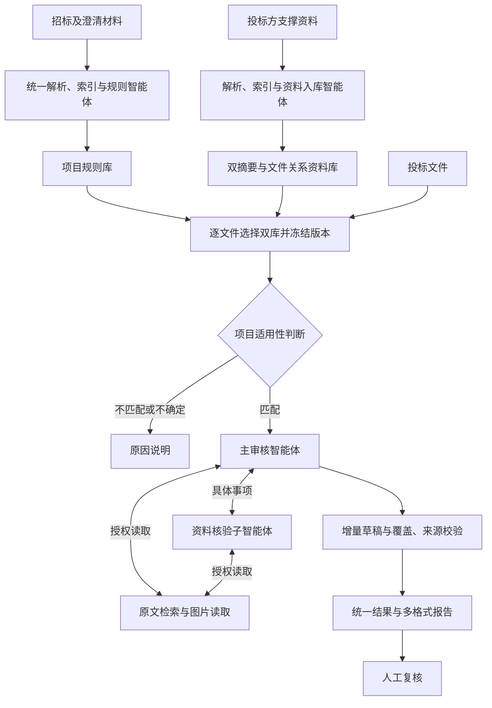

# 第十二届中国研究生智慧城市技术与创意设计大赛
# 创意设计赛项目说明书

作品名称：标智通——面向全场景招投标的多智能体协同审核平台  
参赛赛道：自由赛道  
作品类别：数字化转型，交叉涉及智慧政务  
版本：v1.0（通用定位扩充稿）

> 本稿对应原始附件2。平台采用跨行业通用的材料审核架构，以电力采购作为当前验证场景；【待实测】【待填】保留尚未取得或确认的信息。

## 一、立项依据（不超过2000字）

### 1. 智慧城市公共采购中的共性需求

城市建设与公共服务的背后，是持续发生的货物、工程和服务采购：交通设施需要设备与施工，学校和医院需要仪器与信息系统，城市运行需要能源、物业、检测和运维服务。采购对象各异，但材料审核具有共同结构——从招标文件明确要求，从投标文件读取响应，再用资质、业绩、参数和承诺等材料核对，形成可解释的审查意见。这一环节直接连接城市建设需求、供应主体能力与项目交付条件，是公共资源配置数字化的重要组成部分。

随着材料电子化，文件能够在线传递和留存，内容层面的阅读、比对与判断仍需要专业人员投入。审核负担不仅来自文件数量，还来自同一事项在不同章节、附件和证明材料中的分散表达。对城市管理和采购组织而言，有价值的智能化应当进入这一具体工作过程：让审查要求更加清晰，让风险发现有材料支持，让后续复核能沿着依据追查。

本项目据此提出“标智通”，面向多场景招投标材料提供统一审核能力。项目以电力采购材料进行验证，利用其技术参数、资质与业绩证明并存的特点检验通用流程；系统能力由当前项目规则与资料驱动，不以电力行业标签限定适用对象。

不同角色对同一套材料的关注有所差异：采购组织人员需要完整、一致的审核事项，专业人员关注技术条件与证明范围，复核人员需要快速了解疑点和依据，系统服务商则关注能力能否与现有流程衔接。项目围绕这些需求，将规则维护、材料定位、逐项核验和报告呈现组织在统一工作台中，既支持围绕单个项目深入审查，也为多项目机构复用资料整理能力提供基础。其建设价值体现在技术能力与实际岗位工作的衔接，而非仅增加一个文件问答入口。

### 2. 现有工作方式的难点

**要求变化与清单维护之间的矛盾。** 同类采购也可能在标包范围、阈值、期限和证明要求上不同，澄清、补充文件又会修正原有条件。仅复用历史清单容易遗漏新要求，逐项目重新配置则成本较高。

**投标声明与事实证明之间的距离。** “满足要求”是一项响应，能否得到有效材料支持需要另行核验。合同、验收材料、证书、人员证明等可能共同说明一个事实，文件名相似或主体相同不足以建立证明关系。

**长材料与有限处理能力之间的矛盾。** 正文、表格、扫描件混合出现，重要条件可能位于后部附件。简单截断、只读摘要或只依据单次检索，容易丢失适用条件、否定表达和跨材料差异。

**结果生成与责任复核之间的断点。** 结论缺少来源、使用依据版本不明，或不同导出格式表述变化，都会增加人工复查成本。应用价值因此需要同时回答“发现了什么、依据是什么、哪些仍待核实”。

### 3. 国内外研究、市场与政策动态

检索增强生成、长上下文模型和工具调用为复杂文档处理提供了技术基础，但信息输入更多不必然意味着利用充分。《Lost in the Middle》通过位置变化实验揭示了长上下文信息利用问题；ALCE研究将生成正确性与引用质量分别评价。这些研究提示本项目需要管理阅读范围，并独立评估引用是否真正支持结论，而不只检查输出是否流畅。[长上下文研究](https://arxiv.org/abs/2307.03172)、[引用评价研究](https://aclanthology.org/2023.emnlp-main.398/)

市场方面，国内招采平台已发展出智能辅助评标能力，国际企业采购产品也在引入投标分析智能体。竞争焦点正从“能否读取文件”延伸到场景适配、业务协作、结果质量及系统集成。本项目选择通用材料审核这一可独立交付的能力单元，将项目差异承载在规则和资料中，为不同采购组织提供可配置的审核流程，具体竞品与商业路径见附件3。

国家发展改革委等部门2026年发布的《关于加快招标投标领域人工智能推广应用的实施意见》提出智能辅助评标、报告核验与档案检索等方向。本项目以材料审查、依据管理和人工复核形成应用切入点，与上述方向相衔接。[政策依据](https://www.ndrc.gov.cn/xwdt/tzgg/202602/t20260210_1403681_ext.html)

### 4. 项目目标与城市价值

项目目标是形成可跨项目配置、可追查依据、可协同复核的审核软件：把分散条款整理为可维护规则，把证明资料组织为可查询依据，把审核意见转化为逐项、可回溯的报告。对审核人员，减少重复翻查和整理；对采购组织，沉淀经校核的规则及材料组织经验；对复核人员，提供明确的问题入口、事实依据和待核事项。

系统定位于招投标材料内容审核，最终业务处置由相关人员确认。其通用性来自共享技术流程与动态项目条件，行业适用效果通过分场景验证建立，使城市采购数字化从文件流转进一步深入内容理解、风险提示与审核知识积累。

## 二、项目创新内容（不超过3000字）

### 1. 项目总体思路

项目构建“通用审核流程＋项目规则配置＋证据协同核验”的技术体系，形成规则库、投标方资料库、审核工作台三个业务模块。审核对象、条件和证明范围随项目材料变化，解析、检索、智能体协作与报告交付共用一套流程，以此承载货物、工程和服务采购的差异。

规则库回答“按什么审”，由招标文件及澄清材料形成要求、类别、重要程度、核验方式与来源。资料库回答“用什么证明”，独立组织投标方的资质、合同、参数、人员和其他支撑资料。审核工作台回答“如何形成结论”，为每份投标文件选择对应双库，冻结本次依据，再执行适用性判断、逐项审查和报告交付。同一批次中不同文件可以绑定不同项目与资料库，适应招标服务机构并行处理多个项目的业务组织方式。

系统设置规则整理、资料入库、主审核与资料核验四类智能体职责。主审核负责全局规则与投标响应，子核验围绕具体事项读取相关原件；人员在规则、资料整理和结果复核环节参与确认。用户得到的不只是风险提示，还包括实际发现、判断说明、可用来源和复核建议。

| 适配场景 | 材料审查对象示例 | 共用机制 |
| --- | --- | --- |
| 货物采购 | 技术规格、型号、供货能力、质保响应 | 条件提取、参数材料核对、业绩资料联查 |
| 工程采购 | 资格条件、人员配置、类似项目业绩、工期承诺 | 主体与对象匹配、跨文件核验、范围与期限核对 |
| 服务采购 | 服务方案、团队能力、响应承诺、履约证明 | 要求与响应比对、支撑资料查询、风险归纳 |

上表说明通用架构的场景映射；各领域专业要求由实际招标文件和业务人员校核，验证结果分别报告。

### 2. 可行性分析：项目的技术或实施可行性

**技术基础已经形成。** 后端采用Python、FastAPI和LangGraph，前端采用React与Ant Design Pro；统一解析入口支持文档、表格、PDF与图片，索引支持语义和关键词混合检索及重排。规则维护、资料整理、逐文件任务执行、主子智能体核验及网页、Markdown、JSON、Word输出均已有业务实现，具备围绕具体案例开展端到端演示与评测的基础。

**通用性具有代码结构支撑。** 规则正文和项目简介采用动态文本；六类规则用于组织审核目的，未绑定设备清单或行业阈值；资料摘要与关系由文件内容形成；主审核接收本次规则和材料，报告标题结合当前对象生成。因此，切换采购场景主要发生在输入材料、规则校核和业务验证层，可复用现有解析、检索与执行流程。

**研究与工程能够相互验证。** 仓库配置了单元、契约、集成和端到端测试，便于检查资料范围、工具状态、报告结构及导出一致性；业务有效性另以专家标注、对照实验和重复运行评价。原型已具备主要工作台，实际长文档、多模态与复杂核验的质量和完成率仍处于验证阶段，后续按具体失败类型迭代。

**交付路径可分步推进。** 模型服务、业务规则和报告模板分离，支持按职责调整模型组合；应用及索引保存在本地，可依据客户数据条件规划部署。首批使用聚焦受控环境，企业交付阶段完善认证权限、可靠调度与运维，再形成标准工作台和平台集成模块。

**验证具有可拆解性。** 规则、资料、审核与报告各有独立成果，能够分别检查规则提取是否保留条件、资料摘要是否忠实、证据是否支持判断，以及结果是否完整呈现。某一环节出现偏差时，可沿执行轨迹定位并复测，避免只凭最终报告的整体观感判断质量。这也有利于将研发投入集中到实际限制应用的环节。

### 3. 本项目的特色与创新之处

**（1）以项目语义驱动通用审核，降低固定清单对场景的限制。** 系统从当前招标材料及其澄清、修改中提取审核要求，通过新增、合并、替换维护规则。规则字段保存要求、类别、重要程度、核验方式和来源，提示词约束其保留主体、标包、阈值、单位、期限及例外，并区分必备条件与评分条件。项目差异由有来源的规则表达，六类结构提供统一组织方式，人工可在使用前审阅修订。该设计使专业条件能够随材料更新，减少为每个项目重复编写审核流程的工作。

**（2）将规则与证明资料分开维护，实现复用与任务范围约束的结合。** 招标规则按项目组织，投标方资料独立建库，审核时逐文件绑定二者。可复用的是经整理的规则视图、资料事实与索引，当前结论仍依据本次响应形成。检索同时限定项目、投标方、任务及文件范围，避免相似资料跨主体、跨项目串用。这种结构适合多项目采购组织：共享技术能力，保留各项目条件和主体资料的独立边界。

**（3）用具体核验事项组织多智能体协同，把目录定位推进到原文取证。** 主智能体通过简洁摘要选择“哪份资料能查什么”，再以主体、对象、编号、参数和判断标准委派子智能体；子智能体获取详细摘要、所选文件及一层有依据的直接关联，按需检索或看图。同一事实可以联合多份资料核验，同一规则也可拆成多个事项处理。双摘要降低全量资料进入主会话的负担，文件关系帮助联查，原文和图片支撑事实判断。协同围绕核验任务展开，保留部分支持、矛盾和读取限制供主智能体综合判断。

**（4）将依据版本和实际读取记录贯穿审核，增强结果可复核性。** 任务受理时冻结规则、资料、解析结果与模板，固定本次使用的条件；检索内容被实际展示、图片被实际打开后，系统才登记对应来源。正式引用经过角色、授权范围和解析版本校验，避免直接接受模型生成的来源编号。复核人员由此可以查明某项结论使用了哪一版规则、对应哪些材料。系统校验来源合法性，人员评价其是否充分支持判断，两者配合形成可检查的证据链条。

**（5）把阅读进度、执行观察和报告交付联结起来，形成可持续修订的审核过程。** 长材料按连续完整结构分批，已保存成果与阅读位置相互对应；多轮会话在预算约束下交接上下文，表格和图片转写保持完整结构。智能体及时保存已确认规则的判断，后续事实可修订同一草稿，定稿前检查覆盖与引用。正式结果统一生成多种呈现格式，避免导出时再次让模型改写结论。流程图、调用图和轨迹树提供从阶段到工具细节的观察入口，帮助区分材料疑点、读取困难和执行错误。

**（6）把业务判断的范围写入审核协作规则，支持审慎且可操作的人机复核。** 规则整理阶段区分可从材料核验的要求与需要现场、平台行为记录才能判断的事项；审核阶段区分响应承诺、证明事实与实际履约，保留关键条件和支持范围。比如，履约期限承诺可在投标阶段检查，未来是否如期履约需要后续事实；证书图片能够说明记载内容，真实性仍需相应查验。报告分别提供符合、不符合、风险及人工复核意见，并说明待核内容。通过范围约束、事实表达和复核建议相结合，帮助使用者理解结论能够支持何种业务判断，减少将局部材料支持扩大为整体合格的推断。

上述创新集中于通用业务组织、协作核验和可复核交付。各模块能够单独评价，也能通过消融实验分析组合贡献，为后续场景适配和质量改进提供可检验的技术路线。

## 三、实施方案（不超过3000字）

### 1. 技术路线与实现形态

平台采用浏览器工作台与后端服务协同的软件形态。采购材料通过统一入口进入，经规则与资料整理形成审核依据，按文件执行核验并交付报告。

**材料理解。** 支持DOC、DOCX、XLSX、TXT、Markdown、PDF及图片，将正文、表格和图片入口组织为有序内容，并记录解析版本。可直接提取时读取文本结构，有视觉核验需要时按模型条件调用图片能力。普通正文可切片，表格及图片转写保持完整结构，降低表头、单位与条目脱离的风险。

**规则与资料整理。** 规则智能体逐文件维护要求，保留变更依据；资料入库智能体生成简洁目录、详细摘要和有事实依据的直接关系。人员通过工作台审阅与修订，版本检查防止覆盖较新修改。资料关系提供查询线索，核验仍回到原文或图片。

**定向检索与协作。** 检索先约束业务身份与文件范围，再融合向量、关键词召回并重排。主智能体读取完整规则与投标原文，对需支撑资料的事项委派核验；子智能体在选定及一层关联文件中查询，返回事实与边界。不同投标文件独立执行，并通过有界并发配置控制处理负载。

**有界输入与成果保存。** 全文可容纳时整份读取，超长时按连续结构分批；记录已读范围，必要时进行上下文交接。适用性判断只读前部时明示未读范围。报告通过工具增量维护，未确认部分保留待处理状态；执行错误保留草稿及诊断，正式结果需通过覆盖、字段和引用校验。

### 2. 验证场景与演示设计

首批以电力设备采购验证通用流程。合成红外热成像仪案例包含像素不低于640×480的技术要求、参数资料支撑、投标总价明确缺失以及无关机械加工文件，分别演示参数核对、跨资料查证、商务缺项和适用性判断。合成样例与预设模型回复用于流程演示，真实识别效果由独立模型运行和人工基准评价。

演示采用“同一问题的完整路径”：展示招标要求与规则维护，选择投标文件及对应资料，观察核验委派，打开实际依据，再呈现报告明细和导出结果。补充规则修订前后任务依据保持独立的演示，直观说明版本冻结。跨场景验证拟增加工程、服务采购材料，记录输入和规则变化，保持核心流程一致，检验迁移成本及效果。

现场展示还将选择一项需要联合材料支持的核验事项，先展示资料目录如何定位文件，再展示正文或图片提供的事实及其限制。观众能够观察“为什么选择这些材料、证据支持到什么程度、人员应继续核对什么”，将技术流程转化为可理解的业务操作。

### 3. 实验设计与关键指标

**数据与标准。** 拟建立【待填：项目数】个项目、【待填：文件数】份文件的脱敏数据集，覆盖货物、工程、服务采购及长文本、表格、扫描件、跨材料核验。按项目与供应商划分调试集和保留测试集；当前电力材料与新增行业样本分别统计。拟由两名具备业务能力的人员独立标注规则、关键风险及支持证据，对分歧复核，形成统一基准。人员来源、标注协议、关键风险定义与重复运行次数【待填】，实验前固定。

**对照与消融。** 设置B0人工独立审核、B1单模型直接审查、B2检索增强单模型及本项目完整流程。模型组保持底座、资料和总预算上限一致，共用报告字段、规则覆盖与引用合法性验收要求。先独立评价规则抽取，再以相同人工确认规则比较审核质量，另测端到端表现。去除资料子智能体、双摘要或重排分别进行消融；增加更换行业材料而保持核心代码不变的迁移实验，记录规则校核与适配工作量。

**边界样例。** 针对同一主体但不同合同、评分条件与必备条件混淆、前部缺项但后部有响应、模糊图片和冲突材料设置核验样例，检查系统是否保留必要范围与不确定性；并测试依据修订、错误资料绑定及模型服务异常，分别检查范围校验、版本使用和错误呈现。复杂样例与常规样例分开统计。

| 编号与指标 | 统计口径 | 本项目／参照结果 |
| --- | --- | --- |
| M1 关键风险召回率 | 正确检出的关键风险数／基准关键风险总数，相同事项去重 | 【待实测：%】／【待实测：B1，%】 |
| M2 风险提示精确率 | 经人工确认成立的风险事项数／系统输出的不符合与风险事项总数，按同一业务事项去重 | 【待实测：%】／【待实测：B1，%】 |
| M3 引用证据支持率 | 可回溯且联合支持对应判断的证据组数／抽检证据组数，按规则级结论抽样 | 【待实测：%】／【待实测：B2，%】 |
| M4 完整审核报告产出率 | 满足共同验收要求的文件数／人工基准判定应进入实质审核的文件数 | 【待实测：%】／【待实测：B1，%】 |
| M5 单文件人机协同审核耗时 | 相同交付要求下，从开始处理至人工确认报告的总历时，分钟／份 | 【待实测：分钟】／【待实测：B0，分钟】 |

M1将处理失败、错误排除文件中的未检出风险计为漏检；M4包含错误排除及执行失败，真正不适用的说明报告不计成功。M2无提示、M3无引用时标为不适用并披露数量，人工复核类单独统计，同时报告有可回溯引用的结论占比。M5计入报告准备及失败后的人工补审，分列系统耗时、人工工时、首次建库与复用成本。

按场景、材料形式和风险类型分组报告样本数、均值／中位数及离散程度，保留全部失败。改善计算沿用附件1；补充规则抽取精确率／召回率、规则级结论一致率、人工修订量和单文件模型费用【待实测】，避免用完成报告替代业务正确性评价。

### 4. 实施安排与成果验收

| 阶段 | 主要交付 | 验收重点 |
| --- | --- | --- |
| 原型完善 | 固定双库、提示词和报告版本，优化读取、核验及保存 | 已完成内容可查，错误状态与真实成果一致 |
| 分场景评测 | 专家标注、对照及消融、迁移验证和测试报告 | 原始记录、指标分母与场景差异可核查 |
| 展示定稿 | 固定版本原型、脱敏样例、操作演示和来源报告 | 从规则到原件、结论的完整路径可展示 |
| 受控试点 | 业务试用、部署适配及产品化改进 | 验证质量、复核投入、使用成本与数据边界 |

环境记录【待填：处理器、内存、操作系统、模型版本、参数、并发和日期】。当前原型用于可信环境，企业交付须完善认证权限、任务调度与运维；云端模型路径需明确材料授权和出域范围。软件定位于材料审查，不代替现场行为调查、外部真实性认证或最终评标决定。交付原型、原创业务代码及依赖清单、操作说明、脱敏样例和测试报告。

## 四、应用前景分析（不超过500字）

标智通面向城市建设和公共服务采购，能够以统一的规则、资料与审核流程承载货物、工程和服务类项目。采购组织人员可维护本项目条件，技术与业务人员可围绕关键事项检查响应及支撑材料，复核人员可从报告问题回到对应依据。平台既可作为独立工作台，也可在完成接口适配后嵌入现有采购系统，为不同规模机构提供材料审核能力。

推广采用“通用能力复用、项目条件配置、场景效果验证”的路径。以电力材料完成首批机制与效果验证，再组织工程、服务等不同类型样本进行对照，逐步沉淀经校核的配置方法、验证样例和交付规范。通过年度许可、部署维护及模块集成实现成果转化，客户投入与收益按实际工时、模型费用和复核质量测算。

社会价值在于推动城市采购从文件电子化进一步走向内容可理解、依据可追查、过程可复核，减少重复查找和依据不清造成的沟通，支持规范、公平的材料审查。长期可将经授权积累的规则维护经验、典型问题与评测方法用于持续改进，使智能审核成为可服务多部门、多项目的公共采购数字化能力。

平台将以可复用的软件与验证方法支持场景扩展，让项目经验逐步沉淀为持续改进的审核服务能力。

<!-- 编辑核对，不属于正式提交正文：
本轮以核心代码而非旧README界定产品：app/models/rules.py、app/models/evidence.py、app/audit/bid_summary.py、app/agents/bid_agent.py、app/tools/bid_tools.py、app/audit/sources.py、app/services/audit_management_service.py、app/graph/audit_task_graph.py、app/reports/report_parser_v2.py及configs/prompts/templates。无生产审核逻辑的电力行业硬编码；电力仅当前验证数据。
“全场景”指材料驱动的跨行业通用架构，不表示已完成所有行业验收或覆盖交易全流程。技术指标均待实测，全文所有已实现描述需保持与提交代码版本一致。
本届栏目和限字以raw中的第十二届指南及附件为准。往届调研只用于组织论证和展示思路，不将往届奖项、学校、专利、应用业绩移作本队成果。软件类需另附原型和原创源代码等证明材料，正式提交前补数据、移除编辑说明并检查匿名。
往届调研来源：武汉大学第十届一等奖大模型时空服务平台 https://news.whu.edu.cn/info/2111/473257.htm；北航第九届一等奖“纵横”通用交通智脑 https://graduate.buaa.edu.cn/info/1098/9638.htm；华南理工第十届一等奖交通绿波优化系统 https://news.scut.edu.cn/2024/1219/c41a56640/page.htm；第十一届赛事总结 https://cpipc.acge.org.cn/pw/news/detail/2c9080159a537b96019a7bdec604628b?page=2 。借鉴任务、机制、系统交互和验证相衔接的表达，不把新闻报道归纳为获奖因果或本项目成果。
-->
